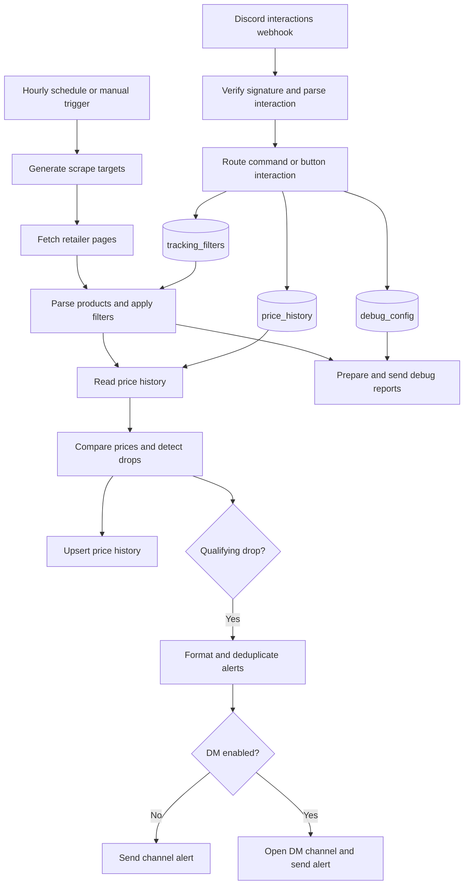

# Implementation

Technical reference for the n8n workflows, retailer parsers, filtering rules, and persistent data models. Workflow and table IDs below identify the originally documented deployment; select the corresponding resources when importing into another instance.

## Architecture

Two main workflows share three n8n Data Tables. A separate renderer workflow serves graph PNGs, and an optional manual initialization workflow seeds missing graph history from existing observations.



## Workflows

### Price tracker

Export: `workflows/donanim-fiyat-takipcisi.json`
Original workflow ID: `KD2PtrGjC8vb1uyL`

- **Triggers:** `Hourly Schedule` runs at `0 * * * *`; `Manual Test` supports manual checks.
- **Generate Scrape Targets:** Produces retailer URLs. The documented configuration uses one request each for İtopya (`?pg=40`) and PcKolik, 13 pages for Gaming.gen.tr, four for GameGaraj, ten for Vatan, and three for MediaMarkt: 32 targets in total.
- **Fetch Target Page:** Uses browser-style User-Agent headers. The documented configuration uses `neverError: true` and `continueRegularOutput` so an individual page failure does not stop the full scan. Inspect status codes and debug output to detect failures.
- **Parse and Apply Filters:** Extracts names, prices, links, stock status, and CPU/GPU/RAM/SSD details, then matches active `tracking_filters`.
- **Get Price History / Compare and Detect Drops:** Compares the current price with stored history, calculates `dropPercent`, and rejects unavailable stock and invalid comparison baselines.
- **Update Price History:** Upserts by `product_id`, storing current price, previous price, and last-check time.
- **Format Notification Items:** Flattens and deduplicates alerts.
- **Is DM Notification?:** Routes to DM when `notify_dm: true` and a Discord user ID are present.
- **Open Discord DM Channel:** Calls `POST /users/@me/channels`.
- **Send Discord DM Alert / Send Discord Alert:** Sends a Discord embed to the selected destination.
- **Debug pipeline:** `Get Debug Config` → `Prepare Debug Messages` → `Send Debug Messages` reports retailer success/failure and extracted product counts.

### Discord command manager

Export: `workflows/discord-slash-komut-yoneticisi.json`
Original workflow ID: `jy2o6YTyzSqg4Amh`

- **Discord Interactions Webhook:** Receives requests at the application's configured Interactions Endpoint URL.
- **Parse Interaction:** Verifies Discord Ed25519 signatures using the pure JavaScript TweetNaCl implementation in the Code node, without an external Node library dependency. Invalid signatures receive HTTP 401. It also reads command options and button `custom_id` values.
- **Command routing:** Inserts, lists, deletes, or updates filters; reads price history for cheapest-system results; and updates debug configuration.

| Command | Behavior |
| --- | --- |
| `/filtre-ekle` | Accepts optional `dahil`, `haric`, `min_fiyat`, `max_fiyat`, `esik_yuzde`, `site`, and `dm`. |
| `/filtre-sil` | Deletes the specified filter ID from `tracking_filters`. |
| `/filtre-listele` | Lists active filters as Discord embeds. |
| `/esik-guncelle` | Updates the price-drop threshold. |
| `/ara` | Searches in-stock systems using optional `model`, `site`, and `siralama`. Sorting choices are En ucuz (`en_ucuz`, default) and En pahalı (`en_pahali`). Results have 10 items per page. |
| `/debug` | Configures the debug channel and verbose product listing. |

Command and option identifiers remain in Turkish for compatibility.

## Retailer extraction

These mechanisms describe the documented implementation. Recheck actual HTTP responses before modifying a parser.

| Retailer | Method | Details |
| --- | --- | --- |
| PcKolik | Embedded Next.js Server Components JSON | Parses the embedded `"systems":[...]` structure for IDs, slugs, hardware facets, and numeric prices. Structured records avoid mixing fields between product cards. |
| İtopya | Category HTML with `?pg=40` | Reads product containers, `h2.eseoContainer` titles, and `.product-price` values from a single comprehensive response. |
| Gaming.gen.tr | WooCommerce HTML | Handles price markup including `translate="no"` and `ins`. Reads CPU, motherboard, GPU, RAM, and SSD details from `.pc-specs-list` and appends them to the title. |
| GameGaraj | Product cards with JSON-LD fallback | Uses the `div.w-full.p-6.hover:scale-105` card markup and `li[data-name]` component lists. Supports JSON-LD `ItemList` as a fallback. |
| Vatan Bilgisayar | Paginated category HTML | Extracts `.product-list__content` records. URL handling prevents duplicated origins when a product URL is already absolute. |
| MediaMarkt | JSON-LD ItemList | Reads structured product prices and availability from the page's JSON-LD. |

Respect robots.txt and avoid redundant pagination. Stop on bot-protection blocks instead of attempting a bypass.

## Filtering

The `matchesFilter` function in `Parse and Apply Filters` applies these rules:

1. **AND matching:** Include keywords can be separated by commas, plus signs, or spaces. Every included term must match the product title.
2. **Model boundaries:** A plain model number excludes suffixed variants such as Ti, Super, or XT.

   ```javascript
   // A search for "5060" excludes "5060 Ti" and "5060 Super".
   pattern = new RegExp('\\b' + inc + '\\b(?!\\s*(?:ti|super|xt))', 'i');
   ```

3. **Suffix normalization:** Joined forms such as `5060Ti`, `5070ti`, and `5080super` are normalized before matching.
4. **Optional include keywords:** An empty `include_keywords` value accepts all systems that satisfy the remaining constraints.
5. **Exclusions:** A matching term in `exclude_keywords` rejects the product.
6. **Price limits:** Products outside `min_price` and `max_price` are rejected.

## Alert safeguards

- **Baseline reset:** A substantial product-name change, such as `DK Gaming` becoming `Cure OEM`, invalidates the old comparison. Setting `previousPrice = currentPrice` prevents a false drop while establishing a fresh baseline.
- **Stock guard:** Products with `in_stock: false` never generate a price-drop notification.
- **DM routing:** When the filter specifies `dm: true`, the workflow opens a DM channel using `discord_user_id` and sends the embed there instead of the shared channel.
- **Secret handling:** Supply bot authentication through n8n credentials. Never store real tokens or public-key configuration in committed workflow exports or logs.

## Data Tables

### tracking_filters

Original table ID: `qY8ZHyILWEQvZ1Mk`

| Column | Type | Purpose |
| --- | --- | --- |
| `id` | Number | Unique, automatically incremented filter ID |
| `include_keywords` | String | Required terms; empty means general tracking |
| `exclude_keywords` | String | Terms that reject a product |
| `min_price` | Number | Minimum price |
| `max_price` | Number | Maximum price |
| `drop_threshold_percent` | Number | Alert threshold; default 5% |
| `source_site` | String | Retailer selector, such as `all`, `gaming_gen_tr`, or `itopya` |
| `is_active` | Boolean | Whether the filter is enabled |
| `notify_dm` | Boolean | Whether alerts go to a DM |
| `discord_user_id` | String | Discord ID of the filter owner |
| `created_at` | DateTime | Creation time |

### price_history

Original table ID: `MZ5jUhvyTbqRUOdk`

| Column | Type | Purpose |
| --- | --- | --- |
| `product_id` | String | Retailer-prefixed unique ID, e.g. `pckolik_PC1072` or `itopya_35805` |
| `source_site` | String | Source retailer |
| `product_name` | String | Full normalized product title |
| `product_url` | String | Direct product URL |
| `current_price` | Number | Latest observed price |
| `previous_price` | Number | Price from the preceding scan |
| `in_stock` | Boolean | Stock availability |
| `last_checked_at` | DateTime | Last check time |
| `chart_history` | String | Versioned JSON containing daily, weekly, and monthly price minima and their actual observation timestamps |

### debug_config

Original table ID: `wru3e3nz0vOoJC2v`

| Column | Type | Purpose |
| --- | --- | --- |
| `id` | Number | Configuration ID (1) |
| `channel_id` | String | Discord channel for debug reports |
| `verbose` | Boolean | Whether detailed product listings are enabled |
| `is_active` | Boolean | Whether debug mode is enabled |
| `updated_at` | DateTime | Last update time |

## Historical scan results

The previous documentation recorded these results for execution `3012`. They were not rerun during the documentation translation and do not establish current retailer availability or coverage.

| Retailer | Pages | Systems |
| --- | ---: | ---: |
| Gaming.gen.tr | 13 | 203 |
| GameGaraj | 4 | 92 |
| İtopya | 1 | 787 |
| PcKolik | 1 | 303 |
| Vatan Bilgisayar | 10 | 113 |
| MediaMarkt | 3 | 25 |
| Total | 32 | 1,523 |

The previous report recorded approximately 26 seconds per scan and a 0% false-notification rate. These are historical observations, not a guarantee.

## Change management

Review recent Git history at the start of every chat. Keep the English and Turkish READMEs and this technical reference current when behavior changes. Before committing any changes made in n8n, export the affected workflows to `./workflows/` and verify that no secrets are included. Follow the user-feedback and commit rules in [AGENTS.md](./AGENTS.md).

## Search command state and verification

The Discord registration payload is stored in `discord/ara.command.json`. The existing command registration was renamed from `/en-ucuz` to `/ara`; model and retailer options are retained. Updating the workflow alone does not update the Discord registration.

`Parse Interaction` maps `siralama` to the internal `sort` field. Missing or unrecognized values default to `en_ucuz`. `Format Cheapest Response` sorts numerically before pagination and sets the result title for ascending or descending order. Product display names are shortened according to URL length to keep typical ten-item responses within the Discord embed description limit.

The optional Discord boolean `eskiler` maps to `include_old` only when its value is exactly `true`. Normal search filters rows before sorting/pagination using `last_checked_at >= Date.now() - 72 hours`; the cutoff is inclusive. Missing/non-string/unparseable timestamps are excluded unless `include_old` is true. This timestamp is refreshed when the tracker observes a product, so removed listings expire without deleting their rows or history. Including old rows does not override the existing in-stock, model, or retailer filters. Debug verbose results bypass freshness filtering.

New search buttons use `ara2_p:page:site:sort:include_old:model`, with `include_old` encoded as `1` or `0`, preserving filters, freshness choice, and order in both directions. Existing `ara_p:page:site:sort:model` and `enc_p:page:site:model` buttons remain supported with old records excluded by default; `enc_p` also defaults to ascending order. Debug buttons retain `dbg_p:page` and ascending order. Internal node names and the `get_cheapest` routing action are retained. The footer identifies whether old records are included.

Executions `3827` and `3828` verified the updated parser and formatter with synthetic fresh/4-day-old rows: the default returned only the fresh row; `eskiler:true` returned both. The fixed-clock search regression tests additionally cover the exact 72-hour boundary, one millisecond past it, invalid/missing timestamps, stock exclusion with old records included, and forward/backward pagination. No retailer scraping, history mutation, or channel/DM alerts are required for these checks. Update the existing Discord command registration using `discord/ara.command.json` when importing this feature.

Run `node tests/search-command.cjs` to check ascending and descending results, default and invalid sorting, model boundaries, retailer filtering, out-of-stock exclusion, next/previous navigation, legacy buttons, empty results, and debug routing.

Manual n8n executions: `3168` verified descending results against stored price history; `3169` verified the default order with model 5060 and PcKolik (56 matches); `3170` verified descending page-two navigation; `3171` verified shortened product names (3,483-character description). These tests read existing data and return webhook responses; they do not perform a fresh retailer scrape or send channel/DM alerts.

## Price graph storage and rendering

### Storage contract

`price_history.chart_history` contains JSON with `version: 1`, `daily`, `weekly`, and `monthly` arrays. Each point has:

```json
{"day":"2026-11-01","price":52199,"observed_at":"2026-11-01T12:00:00.000Z"}
```

`day` identifies the bucket: the local observation day, the Monday of its week, or the first day of its month. `observed_at` identifies when the minimum was actually observed; bucket start dates must never be presented as observation dates. Prices are rounded to two decimal places. A lower observed price replaces the bucket minimum; equal prices keep the earliest timestamp. Other observations are discarded. Out-of-stock, zero, negative, and non-finite prices do not create points.

`lib/price-graphs.js` implements these rules and is embedded in the relevant Code nodes. A parity test checks that exported nodes contain the same helper implementation. `Compare and Detect Drops` updates graph history alongside the existing notification comparison. `Update Price History` persists the added column through its existing upsert. Repeated products within one execution share accumulated minima. Notification thresholds and destinations are unchanged.

Daily buckets retain the current Istanbul day and preceding six days. Weekly buckets retain Monday-based calendar weeks overlapping the latest 30 days; the boundary week includes its full recorded minimum. Monthly buckets are retained indefinitely. The yearly graph displays the current and preceding 11 calendar months; Max displays all active monthly buckets. Unobserved buckets produce gaps, without interpolation. On a product-identity reset, the previous monthly series is preserved in `archived`, while the active graph starts a new series. Ordinary bucket retention still applies.

### Information buttons

`Format Cheapest Response` adds one `price_info:<row_id>` button per displayed product. Ten results use two rows of five buttons, in addition to the pagination row. Labels use the result's displayed rank. Debug listings keep their existing controls. `Parse Interaction` accepts only positive numeric row IDs of at most 15 digits and routes `get_price_graph` to Switch output 8.

`Get Graph Product` reads one row by its built-in Data Table ID. Its normal and error outputs both lead to `Format Graph Info`. The initial information click returns a public Discord response (`type: 4`, no ephemeral flag), containing one weekly graph and a single row of four period buttons. The search message remains available. Each graph has a footer identifying the period minimum and its actual observation day; the PNG repeats this information beneath the plot. Missing or corrupt data produces an explicit message rather than fabricated history.

Period button IDs use `price_graph:<row_id>:<week|month|year|max>`. The parser validates the entire ID, routes it through the same graph lookup, and sets `graphUpdate: true`. `lib/graph-info.js`, embedded in `Format Graph Info`, returns `type: 7` for these clicks, replacing the existing message's single embed and controls. The selected button is highlighted and disabled. Other users can switch the public message's period. Initial `price_info` clicks set `period: week` and `graphUpdate: false`. There is no ephemeral flag on graph replies, including error responses.

### PNG endpoint and provider fallback

`Render Price History Chart` (`5fB0T7QMmEKAmkgG`) serves GET `/webhook/price-history-chart?id=<row_id>&period=<week|month|year|max>`. After validating inputs and reading one row, it calls `Render External Price Chart` (`fMLplWUahgHfnj3M`) with typed string inputs `chart_history`, `period`, and `timestamp`. The provider order is **Szum → QuickChart → local PNG**. Every external failure falls through, including transport errors, timeouts, quota/authentication errors, HTTP failures, and invalid images. Subworkflow errors also route to the existing local renderer. Empty observations skip external calls.

`lib/chart-providers.js` builds Szum's `2026-09-26` ChartDocument with the built-in noir theme and a QuickChart Chart.js 4 configuration. Both request 900 × 500 PNGs with minimum-price/date captions. Szum uses separate series for disconnected segments; QuickChart uses nulls and `spanGaps:false`. Max history is never silently truncated to meet provider limits. HTTP Request nodes use 8-second timeouts, no retries or redirects, full binary responses, and connected error outputs. Validation checks 2xx status, PNG Content-Type, the QuickChart error header, PNG signature, dimensions, chunk bounds/CRCs, IDAT and IEND. The subworkflow returns `{ok, provider, reason, status}` and binary `chart` only on success. Errors are reduced to diagnostic fields rather than returning raw provider errors or authentication headers.

Szum authenticates through the n8n `Szum API` Bearer Auth credential. `.env`'s `SZUM_KEY` is only local configuration and does not populate n8n automatically. QuickChart needs no key. After import, reconnect the credential and the Execute Workflow reference; publish the external workflow before the main renderer. Provider payloads contain only the selected public price series and chart text, never user IDs or tracking filters. [Szum Free](https://szum.io/chart-image-api) includes 500 renders/month. A [QuickChart official community reply from April 2025](https://community.quickchart.io/t/rate-limits-for-quickchart-free-plan/722) gives 60 images/minute and 1,000/month; treat those historical figures as guidance, not a guaranteed allowance.

When both services fail, `lib/chart-png.js` generates the existing indexed PNG with its dark card, turquoise line/area, embedded Segoe UI text, and minimum-price/date panel. PNG generation uses stored DEFLATE blocks, Adler-32, and PNG CRCs, without an installed image library or GPU. The local renderer reads the original Data Table row rather than the failed provider result. Existing `style=3` image URLs retain the font-update cache marker; normal record-update versions continue to refresh observations.

`lib/chart-font.js` contains pre-rendered Segoe UI glyph masks for 12, 18, and 28 pixel text, with 16 alpha levels and run-length encoding. The renderer composites glyphs into its indexed palette rather than scaling a pixel font. Turkish uppercase characters are included. The font masks are embedded in the Code node; there is no font installation, browser, network call, or GPU requirement at runtime. `scripts/build-chart-font.ps1` regenerates the masks on Windows using System.Drawing and Segoe UI. Regeneration also requires updating the embedded font asset in the renderer workflow and exporting that workflow. Tests check font and renderer parity with their exported code.

The binary property `chart` passes through the IF node to `Respond Chart PNG`. Valid responses return `image/png` with a five-minute cache header. Invalid inputs receive 400, missing products 404, corrupt history 500, and storage failures 503. The Data Table error output is wired to the error response. The endpoint is public so Discord's image proxy can retrieve public retail price data; it exposes no filter, user, or credential data. Image URLs include a record-update version to refresh after observations change.

The MCP trigger preview incorrectly included a webhook-ID prefix for this static path. Real HTTP verification established the path above. In exports, `YOUR_PRICE_CHART_ENDPOINT` replaces the live endpoint in `Format Graph Info`; set it to the verified URL after import.

### Initialization and verification

`Initialize Price Graph History` (`RaNbbuEp9PU2lr7s`) is a manual-only, idempotent migration. It reads existing rows and initializes only missing graph history from a positive, in-stock current price and its saved `last_checked_at`. Its update node writes only `chart_history`. It does not reconstruct earlier prices, change filters, send Discord alerts, or run on a schedule. Execution `3175` completed successfully.

Execution `3173` verified ten product-information buttons and preserved pagination. `3174` rejected an invalid graph ID. `3178` verified minimum-price observation dates using stored data. `3177` and `3179` verified local PNG generation and binary responses. Production HTTP checks returned valid PNGs for all four periods, 400 for invalid IDs or periods, and 404 for missing rows. After the redesign, `3202` verified a public single-graph response with four buttons; `3203` and `3204` verified in-place monthly and Max updates; `3205` verified the redesigned PNG binary response. The image layout was visually inspected.

Run all five scripts in `tests/` to verify storage minima and dates, retention, missing observations, product-reset archives, notification guards, button routing, error wiring, exported-helper parity, PNG dimensions, and independent DEFLATE decoding. `chart-providers.cjs` additionally covers payloads, captions, gaps, invalid PNGs, HTTP failures, quota guards, and fallback connections. Live executions `3234`, `3224`, `3225`, `3226`, and `3233` verified real Szum output, real QuickChart after a simulated Szum failure, both-provider failure, local fallback, and empty-history skipping respectively. These tests do not trigger a retailer scrape or channel/DM alert. Exports replace token values with placeholders.

### Rendering resource measurements

The measurements below apply to the local fallback only. Successful external rendering moves rasterization to the provider; n8n still prepares payloads, validates/downloads PNGs, reads history, and stores execution data. It uses no local GPU. Two provider timeouts can add approximately 16 seconds before local rendering, plus workflow overhead. Every image request tries Szum again; there is no persistent quota circuit breaker or server-side image cache.

The font update was checked in n8n execution `3218`: `Build Price Chart` took 429 ms, `Get Chart Product` took 6 ms, and the complete manual workflow took approximately 455 ms. These are elapsed execution times, not measurements of server CPU utilization or server RAM.

Local synthetic measurements used Node v24.18.0 on an Intel Core i5-11320H. Across 20 renders per period, median CPU time was approximately 0.35–0.4 seconds per image. Three fresh-process runs showed about 12.8–12.9 MiB additional process RSS, including first-run compilation, about 0.6 MiB JavaScript heap growth, and 2.7 MiB buffer growth. The indexed PNG was approximately 440 KiB. These memory figures overlap and must not be added together. They are local observations after rendering, not n8n-server peak RAM guarantees. Twenty sequential renders temporarily grew RSS by around 55 MiB in one sample because buffers can await garbage collection or remain allocated for reuse.

Reproduce with `node --expose-gc scripts/benchmark-chart.cjs` or `node --expose-gc scripts/benchmark-chart.cjs --single`. The script distinguishes single-process memory changes from a sequential series. The renderer uses CPU only and runs on image requests; hourly scraping updates history without generating PNGs. Discord or HTTP-client caching may avoid some image requests, but the n8n endpoint has no persistent server-side image cache. Concurrency increases CPU demand and temporary memory use. Existing n8n/task-runner overhead, database reads, execution-data retention, and history storage are additional costs; server RAM has not been profiled.
