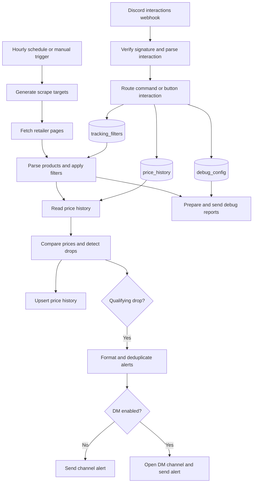

# Implementation

Technical reference for the n8n workflows, retailer parsers, filtering rules, and persistent data models. Workflow and table IDs below identify the originally documented deployment; select the corresponding resources when importing into another instance.

## Architecture

Two workflows share three n8n Data Tables.



## Workflows

### Price tracker

Export: `workflows/donanim-fiyat-takipcisi.json`
Original workflow ID: `KD2PtrGjC8vb1uyL`

- **Triggers:** `Hourly Schedule` runs at `0 * * * *`; `Manual Test` supports manual checks.
- **Generate Scrape Targets:** Produces retailer URLs. The documented configuration uses one request each for İtopya (`?pg=40`) and PcKolik, 13 pages for Gaming.gen.tr, four for GameGaraj, ten for Vatan, and three for MediaMarkt: 32 targets in total.
- **Fetch Target Page:** Uses browser-style User-Agent headers. The documented configuration uses `neverError: true` and `continueRegularOutput` so an individual page failure does not stop the full scan. Inspect status codes and debug output to detect failures.
- **Parse and Apply Filters:** Extracts names, prices, links, stock status, and CPU/GPU/RAM/SSD details, then matches active `tracking_filters`.
- **Get Price History / Compare and Detect Drops:** Compares the current price with stored history, calculates `dropPercent`, and rejects unavailable stock and invalid comparison baselines.
- **Update Price History:** Upserts by `product_id`, storing current price, previous price, and last-check time.
- **Format Notification Items:** Flattens and deduplicates alerts.
- **Is DM Notification?:** Routes to DM when `notify_dm: true` and a Discord user ID are present.
- **Open Discord DM Channel:** Calls `POST /users/@me/channels`.
- **Send Discord DM Alert / Send Discord Alert:** Sends a Discord embed to the selected destination.
- **Debug pipeline:** `Get Debug Config` → `Prepare Debug Messages` → `Send Debug Messages` reports retailer success/failure and extracted product counts.

### Discord command manager

Export: `workflows/discord-slash-komut-yoneticisi.json`
Original workflow ID: `jy2o6YTyzSqg4Amh`

- **Discord Interactions Webhook:** Receives requests at the application's configured Interactions Endpoint URL.
- **Parse Interaction:** Verifies Discord Ed25519 signatures using the pure JavaScript TweetNaCl implementation in the Code node, without an external Node library dependency. Invalid signatures receive HTTP 401. It also reads command options and button `custom_id` values.
- **Command routing:** Inserts, lists, deletes, or updates filters; reads price history for cheapest-system results; and updates debug configuration.

| Command | Behavior |
| --- | --- |
| `/filtre-ekle` | Accepts optional `dahil`, `haric`, `min_fiyat`, `max_fiyat`, `esik_yuzde`, `site`, and `dm`. |
| `/filtre-sil` | Deletes the specified filter ID from `tracking_filters`. |
| `/filtre-listele` | Lists active filters as Discord embeds. |
| `/esik-guncelle` | Updates the price-drop threshold. |
| `/ara` | Searches in-stock systems using optional `model`, `site`, and `siralama`. Sorting choices are En ucuz (`en_ucuz`, default) and En pahalı (`en_pahali`). Results have 10 items per page. |
| `/debug` | Configures the debug channel and verbose product listing. |

Command and option identifiers remain in Turkish for compatibility.

## Retailer extraction

These mechanisms describe the documented implementation. Recheck actual HTTP responses before modifying a parser.

| Retailer | Method | Details |
| --- | --- | --- |
| PcKolik | Embedded Next.js Server Components JSON | Parses the embedded `"systems":[...]` structure for IDs, slugs, hardware facets, and numeric prices. Structured records avoid mixing fields between product cards. |
| İtopya | Category HTML with `?pg=40` | Reads product containers, `h2.eseoContainer` titles, and `.product-price` values from a single comprehensive response. |
| Gaming.gen.tr | WooCommerce HTML | Handles price markup including `translate="no"` and `ins`. Reads CPU, motherboard, GPU, RAM, and SSD details from `.pc-specs-list` and appends them to the title. |
| GameGaraj | Product cards with JSON-LD fallback | Uses the `div.w-full.p-6.hover:scale-105` card markup and `li[data-name]` component lists. Supports JSON-LD `ItemList` as a fallback. |
| Vatan Bilgisayar | Paginated category HTML | Extracts `.product-list__content` records. URL handling prevents duplicated origins when a product URL is already absolute. |
| MediaMarkt | JSON-LD ItemList | Reads structured product prices and availability from the page's JSON-LD. |

Respect robots.txt and avoid redundant pagination. Stop on bot-protection blocks instead of attempting a bypass.

## Filtering

The `matchesFilter` function in `Parse and Apply Filters` applies these rules:

1. **AND matching:** Include keywords can be separated by commas, plus signs, or spaces. Every included term must match the product title.
2. **Model boundaries:** A plain model number excludes suffixed variants such as Ti, Super, or XT.

   ```javascript
   // A search for "5060" excludes "5060 Ti" and "5060 Super".
   pattern = new RegExp('\\b' + inc + '\\b(?!\\s*(?:ti|super|xt))', 'i');
   ```

3. **Suffix normalization:** Joined forms such as `5060Ti`, `5070ti`, and `5080super` are normalized before matching.
4. **Optional include keywords:** An empty `include_keywords` value accepts all systems that satisfy the remaining constraints.
5. **Exclusions:** A matching term in `exclude_keywords` rejects the product.
6. **Price limits:** Products outside `min_price` and `max_price` are rejected.

## Alert safeguards

- **Baseline reset:** A substantial product-name change, such as `DK Gaming` becoming `Cure OEM`, invalidates the old comparison. Setting `previousPrice = currentPrice` prevents a false drop while establishing a fresh baseline.
- **Stock guard:** Products with `in_stock: false` never generate a price-drop notification.
- **DM routing:** When the filter specifies `dm: true`, the workflow opens a DM channel using `discord_user_id` and sends the embed there instead of the shared channel.
- **Secret handling:** Supply bot authentication through n8n credentials. Never store real tokens or public-key configuration in committed workflow exports or logs.

## Data Tables

### tracking_filters

Original table ID: `qY8ZHyILWEQvZ1Mk`

| Column | Type | Purpose |
| --- | --- | --- |
| `id` | Number | Unique, automatically incremented filter ID |
| `include_keywords` | String | Required terms; empty means general tracking |
| `exclude_keywords` | String | Terms that reject a product |
| `min_price` | Number | Minimum price |
| `max_price` | Number | Maximum price |
| `drop_threshold_percent` | Number | Alert threshold; default 5% |
| `source_site` | String | Retailer selector, such as `all`, `gaming_gen_tr`, or `itopya` |
| `is_active` | Boolean | Whether the filter is enabled |
| `notify_dm` | Boolean | Whether alerts go to a DM |
| `discord_user_id` | String | Discord ID of the filter owner |
| `created_at` | DateTime | Creation time |

### price_history

Original table ID: `MZ5jUhvyTbqRUOdk`

| Column | Type | Purpose |
| --- | --- | --- |
| `product_id` | String | Retailer-prefixed unique ID, e.g. `pckolik_PC1072` or `itopya_35805` |
| `source_site` | String | Source retailer |
| `product_name` | String | Full normalized product title |
| `product_url` | String | Direct product URL |
| `current_price` | Number | Latest observed price |
| `previous_price` | Number | Price from the preceding scan |
| `in_stock` | Boolean | Stock availability |
| `last_checked_at` | DateTime | Last check time |

### debug_config

Original table ID: `wru3e3nz0vOoJC2v`

| Column | Type | Purpose |
| --- | --- | --- |
| `id` | Number | Configuration ID (1) |
| `channel_id` | String | Discord channel for debug reports |
| `verbose` | Boolean | Whether detailed product listings are enabled |
| `is_active` | Boolean | Whether debug mode is enabled |
| `updated_at` | DateTime | Last update time |

## Historical scan results

The previous documentation recorded these results for execution `3012`. They were not rerun during the documentation translation and do not establish current retailer availability or coverage.

| Retailer | Pages | Systems |
| --- | ---: | ---: |
| Gaming.gen.tr | 13 | 203 |
| GameGaraj | 4 | 92 |
| İtopya | 1 | 787 |
| PcKolik | 1 | 303 |
| Vatan Bilgisayar | 10 | 113 |
| MediaMarkt | 3 | 25 |
| Total | 32 | 1,523 |

The previous report recorded approximately 26 seconds per scan and a 0% false-notification rate. These are historical observations, not a guarantee.

## Change management

Review recent Git history at the start of every chat. Keep the English and Turkish READMEs and this technical reference current when behavior changes. Before committing any changes made in n8n, export the affected workflows to `./workflows/` and verify that no secrets are included. Follow the user-feedback and commit rules in [AGENTS.md](./AGENTS.md).

## Search command state and verification

The Discord registration payload is stored in `discord/ara.command.json`. The existing command registration was renamed from `/en-ucuz` to `/ara`; model and retailer options are retained. Updating the workflow alone does not update the Discord registration.

`Parse Interaction` maps `siralama` to the internal `sort` field. Missing or unrecognized values default to `en_ucuz`. `Format Cheapest Response` sorts numerically before pagination and sets the result title for ascending or descending order. Product display names are shortened according to URL length to keep typical ten-item responses within the Discord embed description limit.

New search buttons use `ara_p:page:site:sort:model`, preserving filters and order in both directions. Existing `enc_p:page:site:model` buttons remain supported with ascending order. Debug buttons retain `dbg_p:page` and ascending order. Internal node names and the `get_cheapest` routing action are retained.

Run `node tests/search-command.cjs` to check ascending and descending results, default and invalid sorting, model boundaries, retailer filtering, out-of-stock exclusion, next/previous navigation, legacy buttons, empty results, and debug routing.

Manual n8n executions: `3168` verified descending results against stored price history; `3169` verified the default order with model 5060 and PcKolik (56 matches); `3170` verified descending page-two navigation; `3171` verified shortened product names (3,483-character description). These tests read existing data and return webhook responses; they do not perform a fresh retailer scrape or send channel/DM alerts.
