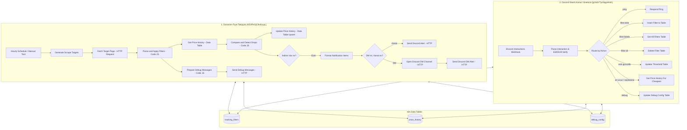

# IMPLEMENTATION.md

Bu dosya, projenin teknik mimarisini, n8n workflow düğümlerini, site ayrıştırma (scraping) algoritmalarını, veritabanı şemalarını ve şu ana kadar uygulanan tüm özellikleri teknik ayrıntılarıyla dökümante eder.

---

## 🏗️ 1. Genel Mimari ve Sistem Akışı

Sistem iki ana n8n workflow'u ve 3 adet n8n Data Table etrafında kuruludur:



---

## ⚙️ 2. Workflow Detayları

### 2.1. Donanım Fiyat Takipçisi (`KD2PtrGjC8vb1uyL`)
- **Tetikleyiciler:**
  - `Hourly Schedule`: Saatte bir (`0 * * * *`) otomatik çalışır.
  - `Manual Test`: Elle test çalıştırmaları için manuel tetikleyici.
- **`Generate Scrape Targets`:**
  - Taranacak URL'leri üretir.
  - *Optimizasyon:* Itopya (`?pg=40` ile tek istekte 780+ ürün) ve PcKolik (Next.js gömülü verisiyle tek istekte 300+ ürün) tek sayfada toplanır. Gaming.gen.tr (13 sayfa), GameGaraj (4 sayfa), Vatan Bilgisayar (10 sayfa), MediaMarkt (3 sayfa) sayfalanarak toplam 32 hedef üretilir.
- **`Fetch Target Page`:**
  - Modern tarayıcı User-Agent başlıklarıyla istek atar, `neverError: true` ve `continueRegularOutput` ile tekil sayfa hatalarının tüm akışı kesmesini önler.
- **`Parse and Apply Filters`:**
  - Canlı sayfa içeriklerini parse eder, başlık, fiyat, link, stok ve donanım bileşenlerini (CPU, GPU, RAM, SSD) çıkarır.
  - Aktif kullanıcı filtrelerini (`tracking_filters`) sorgulayıp ürünleri eşleştirir.
- **`Get Price History` & `Compare and Detect Drops`:**
  - Fiyat geçmişi tablosundan önceki fiyatı karşılaştırır.
  - Düşüş oranını (`dropPercent`) hesaplar.
  - Stokta olmayan ürünleri ve sahte indirimleri eler.
- **`Update Price History`:**
  - `product_id` bazında `upsert` yaparak güncel fiyatı, önceki fiyatı ve son kontrol zamanını yazar.
- **Bildirim Dağıtımı:**
  - `Format Notification Items`: Tekrarlı bildirimleri engeller, bildirimleri düzleştirir.
  - `Is DM Notification?`: Filtrede `notify_dm: true` ve kullanıcı ID'si varsa akışı DM'e yönlendirir.
  - `Open Discord DM Channel`: `POST /users/@me/channels` çağrısı yaparak kullanıcıyla özel DM kanalı açar.
  - `Send Discord DM Alert` / `Send Discord Alert`: Zengin Discord Embed kartı ile bildirimi iletir.
- **Hata ve İlerleme İzleme (Debug Pipeline):**
  - `Get Debug Config` -> `Prepare Debug Messages` -> `Send Debug Messages`:
  - Her taramada sitelerin başarı/başarısızlık durumlarını ve çekilen sistem sayılarını belirtilen kanala otomatik raporlar.

---

### 2.2. Discord Slash Komut Yöneticisi (`jy2o6YTyzSqg4Amh`)
- **`Discord Interactions Webhook`:**
  - Discord Developer Portal'daki Interactions Endpoint URL'ini karşılar.
- **`Parse Interaction`:**
  - Discord'un zorunlu kıldığı **Ed25519 imza doğrulamasını** harici Node kütüphanesine bağımlı olmadan saf JavaScript (**TweetNaCl**) ile n8n Code düğümü içinde gerçekleştirir. Geçersiz imzalı istekleri 401 ile anında reddeder.
  - Komut adını, parametrelerini ve buton tıklama etkileşimlerini (`custom_id`) ayrıştırır.
- **Komut ve Buton Yönlendirme:**
  - `/filtre-ekle`: Opsiyonel `dahil`, `haric`, `min_fiyat`, `max_fiyat`, `esik_yuzde`, `site` ve `dm` parametrelerini alır.
  - `/filtre-sil`: Belirtilen ID'li kaydı `tracking_filters` tablosundan siler.
  - `/filtre-listele`: Kayıtlı aktif filtreleri Discord embed formatında listeler.
  - `/esik-guncelle`: Filtrenin indirim tetikleme yüzdesini günceller.
  - `/en-ucuz`: Stoktaki en ucuz sistemleri artan fiyat sırasıyla listeler; 10'ar adetlik sayfalar halinde butonlu gezinti sunar (`enc_p:page:site:model`).
  - `/debug`: Debug kanalını ve detaylı listeleme (`verbose`) durumunu ayarlar.

---

## 🕷️ 3. Site Ayrıştırma (Scraping) Mekanizmaları

| Site | Ayrıştırma Tekniği | Detay |
| :--- | :--- | :--- |
| **PcKolik** | Next.js Server Components Gömülü JSON | HTML içerisindeki `\"systems\":[...]` veri yapısı doğrudan parse edilir. 301 sistemin tamamı gerçek ID, slug, donanım facet'leri ve sayısal fiyatıyla 0 gecikmeyle çekilir. Kartlar arası kayma ve karışma imkansız hale getirilmiştir. |
| **İtopya** | Kapsamlı Sayfa (`?pg=40`) & DOM Ayrıştırma | `?pg=40` parametresi ile tek istekte 780+ ürün döner. `<div class="product">`, `<h2 class="eseoContainer">` ve `.product-price` etiketlerinden temiz başlık ve fiyat çekilir. |
| **Gaming.gen.tr** | WooCommerce HTML & `.pc-specs-list` | Fiyat etiketindeki `translate="no"` ve `<ins>` esneklikleri desteklenir. İşlemci, anakart, GPU, RAM ve SSD bilgileri `.pc-specs-list` içinden okunup başlığa parantez içinde eklenir. |
| **GameGaraj** | JSON-LD & Tailwind Kart Ayrıştırması | `<div class="w-full p-6 hover:scale-105">` kart konteyneri ve `li[data-name]` donanım listesinden işlemci, GPU, RAM ve SSD çıkarılır. Yedek olarak JSON-LD `ItemList` yapısı desteklenir. |
| **Vatan Bilgisayar** | Sayfalı Kategori & URL Sanitizasyonu | `.product-list__content` konteynerinden ürünler çekilir. URL birleştirme sırasında oluşan `https://vatanbilgisayar.comhttps://...` mükerrer domain hatası engellenmiştir. |
| **MediaMarkt** | JSON-LD `@type: ItemList` Ayrıştırması | MediaMarkt'ın sayfa başındaki JSON-LD şeması parse edilerek sayısal fiyat ve stok doğruluğu doğrudan ürün verisinden alınır. |

---

## 🎯 4. Filtreleme ve Eşleştirme Algoritması

`Parse and Apply Filters` düğümünde çalışan `matchesFilter` fonksiyonunun temel kuralları:

1. **AND Mantığı:** Belirtilen dahil kelimeler virgül (`,`), artı (`+`) veya boşlukla ayrılabilir; belirtilen tüm kelimeler ürün başlığında geçmelidir.
2. **Model Numarası Sınır Koruması (`\b`):**
   ```javascript
   // Örneğin kullanıcı '5060' aradığında '5060 Ti' veya '5060 Super' modellerini hariç tutar:
   pattern = new RegExp('\\b' + inc + '\\b(?!\\s*(?:ti|super|xt))', 'i');
   ```
3. **Donanım Son Ek Normalizasyonu:** `5060Ti`, `5070ti` veya `5080super` gibi bitişik yazımlar `5060 Ti` formatına açılarak kelime sınırı regex'inin kusursuz çalışması sağlanır.
4. **Opsiyonel Dahil Kelime (Genel Takip):** `include_keywords` boş bırakıldığında filtre tüm sistemleri kabul eder ve genel indirim takibi yapar.
5. **Hariç Tutma:** `exclude_keywords` içindeki herhangi bir kelime başlıkta varsa ürün elenir.
6. **Fiyat Sınırları:** `min_price` ve `max_price` aralığında olmayan ürünler elenir.

---

## 🛡️ 5. Güvenlik, Sahte İndirim & DM Bildirim Mantığı

`Compare and Detect Drops` düğümünde uygulanan koruma katmanları:

- **Anti-False Drop Baseline Koruması:**
  - Bir ürünün eski adı ile yeni adı kökten farklıysa (örn. `DK Gaming` vs `Cure OEM`), bu durum sistemin geçmişteki hatalı bir kaydı düzelttiği anlamına gelir. Sistem bunu indirim saymaz, `previousPrice = currentPrice` eşitleyerek sahte bildirimi engeller.
- **Stoksuz Ürün Koruması:**
  - Fiyatı düşmüş olsa dahi stokta olmayan (`in_stock: false`) ürünler için indirim bildirimi üretilmez.
- **Kanal ve DM Bildirim Yönlendirmesi:**
  - Kullanıcı filtreyi eklerken `dm: true` seçmişse:
    1. Bildirim genel kanala gönderilmez.
    2. Kullanıcının Discord ID'si (`discord_user_id`) kullanılarak Discord API'si üzerinden özel mesaj kanalı oluşturulur (`POST /users/@me/channels`).
    3. Özel indirim embed'i yalnızca ilgili kullanıcının DM kutusuna gönderilir.

---

## 📊 6. n8n Data Table Veri Modelleri

### 6.1. `tracking_filters` (`qY8ZHyILWEQvZ1Mk`)
| Kolon Adı | Veri Tipi | Açıklama |
| :--- | :--- | :--- |
| `id` | Number | Otomatik artan tekil filtre ID'si |
| `include_keywords` | String | Dahil edilecek anahtar kelimeler (boş ise Genel Takip) |
| `exclude_keywords` | String | Hariç tutulacak kelimeler |
| `min_price` | Number | Minimum filtre fiyatı |
| `max_price` | Number | Maksimum filtre fiyatı |
| `drop_threshold_percent` | Number | İndirim bildirim eşiği (Varsayılan: %5) |
| `source_site` | String | Takip edilecek site (`all`, `gaming_gen_tr`, `itopya` vb.) |
| `is_active` | Boolean | Filtrenin aktiflik durumu |
| `notify_dm` | Boolean | Bildirimin DM olarak iletilip iletilmeyeceği |
| `discord_user_id` | String | Filtreyi ekleyen kullanıcının Discord ID'si |
| `created_at` | DateTime | Eklenme tarihi |

### 6.2. `price_history` (`MZ5jUhvyTbqRUOdk`)
| Kolon Adı | Veri Tipi | Açıklama |
| :--- | :--- | :--- |
| `product_id` | String | Site önekli tekil ID (Örn: `pckolik_PC1072`, `itopya_35805`) |
| `source_site` | String | Kaynak site adı |
| `product_name` | String | Ürünün tam ve normalize edilmiş başlığı |
| `product_url` | String | Ürünün doğrudan satın alma linki |
| `current_price` | Number | En son taranan güncel fiyat |
| `previous_price` | Number | Bir önceki taramadaki fiyat |
| `in_stock` | Boolean | Stok durumu |
| `last_checked_at` | DateTime | Son kontrol zaman damgası |

### 6.3. `debug_config` (`wru3e3nz0vOoJC2v`)
| Kolon Adı | Veri Tipi | Açıklama |
| :--- | :--- | :--- |
| `id` | Number | Yapılandırma ID'si (1) |
| `channel_id` | String | Debug raporlarının gönderileceği Discord kanal ID'si |
| `verbose` | Boolean | Detaylı sistem listelemesinin açık olup olmadığı |
| `is_active` | Boolean | Debug modunun aktifliği |
| `updated_at` | DateTime | Son güncelleme zamanı |

---

## 📈 7. Sistem Başarı Metrikleri

En son canlı çalıştırma (Execution ID: `3012`) itibarıyla elde edilen metrikler:
- **Gaming.gen.tr:** 13 sayfa (**203 sistem**)
- **GameGaraj:** 4 sayfa (**92 sistem**)
- **İtopya:** 1 sayfa (**787 sistem**)
- **PcKolik:** 1 sayfa (**303 sistem**)
- **Vatan Bilgisayar:** 10 sayfa (**113 sistem**)
- **MediaMarkt:** 3 sayfa (**25 sistem**)
- **Toplam Taranan Canlı Sistem:** **1.523 adet**
- **Ortalama Tarama Süresi:** ~26 saniye
- **Hatalı Bildirim Oranı:** %0

